# FluxStats

[](https://github.com/zSnowww/FluxStats/actions/workflows/ci.yml)
[](https://github.com/zSnowww/FluxStats/releases)
[](LICENSE)

Dynamic SVG cards for your GitHub README. Built with [Hono](https://hono.dev) on Bun.




```md

```

## Cards

All cards accept the common parameters below, plus their own.

| Card               | Endpoint                    | Own parameters                                                                                                  |
| ------------------ | --------------------------- | --------------------------------------------------------------------------------------------------------------- |
| Stats              | `/api/github/stats`         | `show_icons` (`true`)                                                                                           |
| Languages          | `/api/github/languages`     | `langs_count` (1-10, `6`), `hide` (`html,css`), `layout` (`bars` \| `compact`), `palette` (`theme` \| `github`) |
| Contributions      | `/api/github/contributions` | `type`: `calendar` (heatmap) or `activity` (weekly curve + current/longest streak)                              |
| Streak             | `/api/github/streak`        | — (all-time total, current and longest streak, last 30 days)                                                    |
| Top repos          | `/api/github/repos`         | `repos_count` (1-10, `5`), `exclude` (`repo-a,repo-b`), `hide_archived` (`false`), `palette`                    |
| Currently building | `/api/github/building`      | `repos_count` (1-10, `5`); public repos ranked by commits in the last 30 days                                   |
| Profile            | `/api/github/profile`       | `show_icons`, `langs_count`, `hide`, `palette` (stats + languages + streak in one card)                         |

Top repos never lists the profile README repo (`user/user`). The streak card covers the
user's whole history: it asks GitHub for every contribution year in a single aliased query.

Calendar, activity, streak and profile contributions also read the public profile calendar,
including anonymous private activity when the user enables GitHub's **Private contributions**.
Public calendar requests use no token and are cached for one hour per profile/range per running
instance (the deployment CDN also caches cards). If GitHub's HTML changes or cannot be fetched,
the cards fall back to API counts; API counts are never reduced. Profile commits remain an API
metric and are not inferred from anonymous calendar totals.

**Currently building** lists up to 100 public repositories returned by GitHub's contribution
API, ranked by the user's commit contributions over the last 30 UTC calendar days (including today).
The card displays the top `repos_count`. **Private & other work** is the period's total minus
those displayed commits: it includes anonymous private activity, omitted repositories, issues,
pull requests, reviews and other contribution types. It is not a count of private commits.
Private and internal repository names are never displayed, even if the token can access them.

```md

```

Languages are measured by code size across the user's public, non-fork repos; anything past
`langs_count` is grouped into "Other". `palette=theme` (default) shades the theme accent;
`palette=github` uses GitHub's Linguist colors.

### Decoration

Static pieces for the rest of a README. They don't call GitHub, so they're cached for a day.
All take `theme` and the color overrides.

| Piece    | Endpoint              | Parameters                                                                                                                                                          |
| -------- | --------------------- | ------------------------------------------------------------------------------------------------------------------------------------------------------------------- |
| Terminal | `/api/decor/terminal` | `lines` (`;`-separated, up to 8), `prompt` (`~ $`), `title`, `width` (320-1000). Types and erases each line in a loop (SMIL, which GitHub animates inside ``). |
| Badge    | `/api/decor/badge`    | `label`, `value`, `icon` (`globe`, `telegram`, `instagram`, `mail`, `github`, `link`, `clock`, …). Wrap it in a link: SVG inside `` can't be clicked.          |
| Divider  | `/api/decor/divider`  | `label` (a word or a kanji), `width` (200-1200). Transparent background.                                                                                            |

Text in decoration uses a monospace font: SVG can't measure text, so widths are computed per
character (CJK and emoji count as double width).

### Themes

| Group         | Themes                                                                                                                               |
| ------------- | ------------------------------------------------------------------------------------------------------------------------------------ |
| FluxStats     | `graphite` (default), `midnight`, `forest`, `ember`                                                                                  |
| Ryoku schemes | `nord`, `tokyo-night`, `catppuccin-mocha`, `rose-pine`, `gruvbox`, `dracula`, `everforest`, `kanagawa`, `one-dark`, `solarized-dark` |
| Omarchy       | `ryoku`, `aether`, `aether-sakura`                                                                                                   |
| GitHub        | `github-dark`, `github-light`, `paper`                                                                                               |

Every theme is checked for WCAG AA text contrast in `tests/unit/themes.test.ts`.

### Common parameters

| Param                                                                   | Default    | Notes                                                       |
| ----------------------------------------------------------------------- | ---------- | ----------------------------------------------------------- |
| `username`                                                              | —          | required                                                    |
| `theme`                                                                 | `graphite` | see [Themes](#themes)                                       |
| `hide_border`                                                           | `false`    |                                                             |
| `animate`                                                               | `true`     | subtle entry animations (off with `prefers-reduced-motion`) |
| `bg_color`, `title_color`, `text_color`, `accent_color`, `border_color` | —          | hex, with or without `#`                                    |

## Self-hosting

There is no public instance: run your own, with your own GitHub API quota.

[](https://vercel.com/new/clone?repository-url=https%3A%2F%2Fgithub.com%2FzSnowww%2FFluxStats&env=GITHUB_TOKEN&envDescription=GitHub%20token%20with%20read-only%20access%20to%20public%20data)

1. [Create a GitHub token](https://github.com/settings/tokens). A classic token with no scopes is
   enough. Don't grant access to private repositories: the cards don't need it.
2. Deploy with the button and set `GITHUB_TOKEN`. To update later, sync your copy and redeploy.
3. Use your deployment URL in place of `your-host`.

To run it on your own server instead, set `GITHUB_TOKEN` (and optionally `PORT`) in `.env`, then
`bun install && bun run start`. The cache is in memory, so put a CDN or caching proxy in front
if you expect traffic.

## Development

```sh
cp .env.example .env   # add a GITHUB_TOKEN
bun install
bun run dev            # http://localhost:3100 opens the card generator
bun run preview        # renders every card × theme into preview/index.html with sample data
bun test
bun run typecheck
```

## Layout

```
src/
  app.ts            Hono app and route mounting
  pages/            generator page (Hono JSX, server-rendered)
  routes/           HTTP: parse query → fetch → render
  github/           GraphQL helper + one fetcher per card (stats, languages, contributions)
  cards/            SVG renderers; frame.ts is the shared shell
  themes/           theme tokens + overrides
  domain/           models, schemas, Result, AppError
  lib/              escaping, chart helpers (axes, month ticks), TTL cache
```

`public/assets/` holds the generator's client script and styles (plain JS/CSS, no build step).

Adding a theme = one object in `src/themes/index.ts` (plus its group in `THEME_GROUPS`). Adding a card = a renderer in
`src/cards/` built on `renderFrame`, plus a route.

## Contributing

See [CONTRIBUTING.md](CONTRIBUTING.md). To report a vulnerability, see [SECURITY.md](SECURITY.md).

## License

[MIT](LICENSE)
